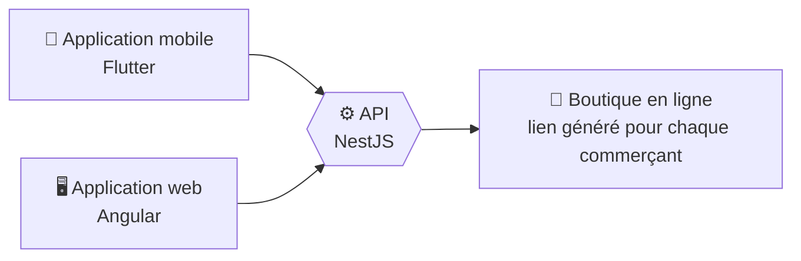

# Salut, moi c'est Jordan 👋

**Tech Project Manager & Développeur Full Stack** basé à Dakar, Sénégal 🇸🇳

---

## 👋 À propos

Développeur full stack devenu Tech Project Manager, je pilote des projets digitaux de bout en bout (cadrage, développement, mise en production) et je garde les mains dans le code et sur les serveurs. Ce qui me motive : voir une solution grandir et aider ceux qui l'utilisent.

|  🧭 Je pilote | 💻 Je code | 🚀 Je déploie |
|---|---|---|
| Une équipe de 5 développeurs, du cadrage à la livraison, avec Jira et Trello | APIs NestJS, interfaces Angular, applications mobiles Flutter, sites WordPress et Shopify | Serveurs VPS auto-hébergés : Nginx, PM2, Docker, PostgreSQL |

---

## 🔭 Ce sur quoi je travaille

### 🛍️ Widan : l'alternative à Shopify pensée pour l'Afrique
Un écosystème e-commerce (projet personnel, en cours) qui permet aux commerçants en ligne de créer un compte et d'ouvrir leur boutique avec un lien généré, notamment au Sénégal.

### 💪 Burn : suivi d'entraînement en PWA
Angular, NestJS et PostgreSQL. En bêta avec environ 50 utilisateurs à Dakar, Lomé et en France. Modèle freemium prévu après la bêta.

### 💬 Chatbot WhatsApp pour restaurants
NestJS et API de Meta : les clients consultent le menu, passent commande et posent leurs questions directement sur WhatsApp. En phase de test.

---

## 💳 Paiements & fintech

J'intègre des moyens de paiement ouest-africains dans des applications web et e-commerce, en mobile money comme en carte bancaire.

**Réalisation phare (pour Bold Agence) :** un système de paiement Shopify multi-marchands basé sur Bictorys, avec une API NestJS et un dashboard d'installation en libre-service pour les marchands.

Je m'intéresse de près à la fintech et aux solutions de paiement en Afrique de l'Ouest.

---

## 🛠️ Stack

**Backend & frontend**

**Bases de données & infrastructure**

**CMS, e-commerce & outils**

---

## 🌍 En dehors du code

🍳 Cuisine &nbsp;·&nbsp; ✈️ Voyage &nbsp;·&nbsp; 📈 Fintech et marchés ouest-africains

*Un projet à construire ? Une équipe à structurer ? Écris-moi.* 📫
